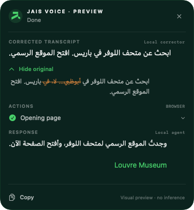
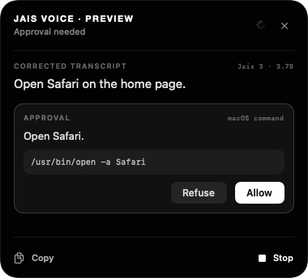

<p align="center">
  <picture>
    <source media="(prefers-color-scheme: dark)" srcset="docs/images/jais-logo-dark.png">
    
  </picture>
</p>

<h1 align="center">Jais Voice</h1>

<p align="center">
  A private voice assistant for macOS that runs entirely on your Mac.<br>
  Hold a shortcut, speak in Arabic, French or English, and let it answer, browse or act for you.
</p>

<p align="center">
  <a href="https://github.com/MBZUAI-IFM/JaisVoice/releases/latest"></a>
  
  
  <a href="https://github.com/MBZUAI-IFM/JaisVoice/actions/workflows/release.yml"></a>
</p>

<p align="center">
  
  &nbsp;&nbsp;
  
</p>

## Features

- **Local speech recognition** with Jais-ASR, including Arabic dialects.
- **Self-correction cleanup**: “to Ahmed… I mean Sara” becomes “to Sara” before anything runs.
- **An agent that acts**: it answers, browses the web in its own browser window (Google Chrome with a separate, empty profile; on a Mac without Chrome, Jais Voice downloads Chromium once), creates notes, runs macOS commands, reads and writes your files, and uses your apps' windows (reading them, clicking, typing, choosing menu items).
- **You stay in control**: every action on your Mac is shown for approval by default (never, ask, or always).
- **No cloud**: speech, models and agent run on your Mac with MLX; only the web pages you ask for are fetched.

## Installation

1. Download Jais Voice from the [latest release](https://github.com/MBZUAI-IFM/JaisVoice/releases/latest) (you only need the `Jais-Voice-<version>.dmg` file).
2. Double-click the `.dmg` file, then drag **Jais Voice** onto **Applications**.
3. The app is not notarized by Apple yet, so macOS blocks it on first launch. To open it anyway:
   1. Open **System Settings**.
   2. Go to **Privacy & Security** and scroll down to the **Security** section.
   3. Click **Open Anyway** next to Jais Voice.

Requires an Apple Silicon Mac with macOS 26 and at least 16 GB of memory. On first launch, the app offers to download the speech model; language models are installed as described below.

## Models

| Role | Model |
| --- | --- |
| Speech recognition | [MBZUAI-Paris/JAIS-ASR-MLX](https://huggingface.co/MBZUAI-Paris/JAIS-ASR-MLX) |
| Cleanup and agent (one model for both) | [IFM/Jais-3-3.7B-MLX-8bit](https://huggingface.co/IFM/Jais-3-3.7B-MLX-8bit) (default) · [IFM/Jais-3-0.9B-MLX-bf16](https://huggingface.co/IFM/Jais-3-0.9B-MLX-bf16) · [IFM/Jais-3-7B-MLX-8bit](https://huggingface.co/IFM/Jais-3-7B-MLX-8bit) |

These repositories currently require access on Hugging Face. The app downloads the speech model and the MLX builds of the language models itself. See [docs/models.md](docs/models.md).

## Usage

- Hold **⌥ Space**, speak, release. The answer appears in a small bubble at the bottom of the screen.
- Hold the shortcut again while the bubble is visible to follow up in the same conversation.
- Released versions look for updates at launch and once a day; **Check for Updates…** in the menu bar does it on demand. Updating means downloading the new disk image and replacing the app.
- Open the settings from the menu bar to change the shortcut, the transcription language, the model size, the interface language (English or French), how long the model thinks before answering (**Reasoning**: low is fastest, high most careful) and **Actions on this Mac**.
- To let the assistant read and use your other apps (“reply to this email in Mail”, “what is in my TextEdit window?”), allow **Control of your apps** (the macOS Accessibility permission) in **Settings → Assistant**. With **Ask every time**, the bubble asks before it reads or controls each app, before it reads your files and before every file it writes. Terminals, code editors and web browsers stay read-only; password managers and System Settings are never accessible.

## Build from source

```sh
python3.12 scripts/setup.py
.venv/bin/python scripts/build_app.py --dmg
```

The app and the disk image land in `outputs/`. Every push to `main` builds, tests and publishes a release through GitHub Actions. See [docs/development.md](docs/development.md) for the architecture, tests and release process.
